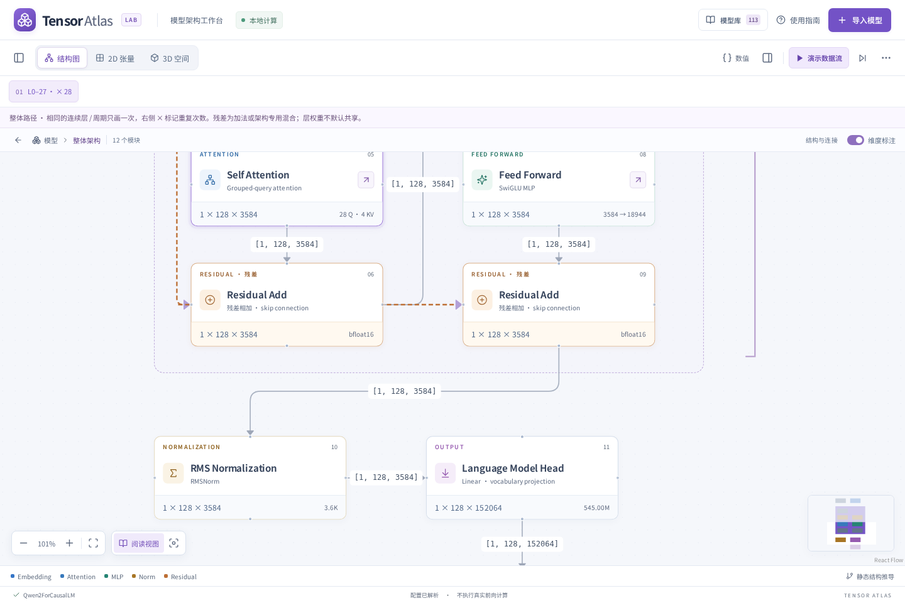
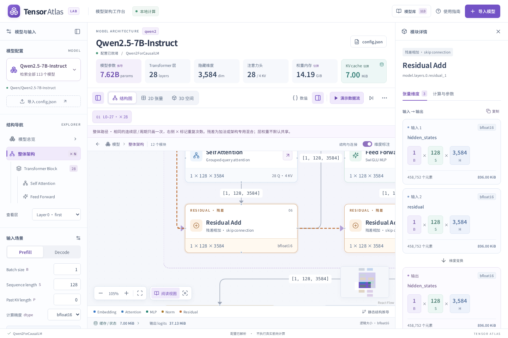
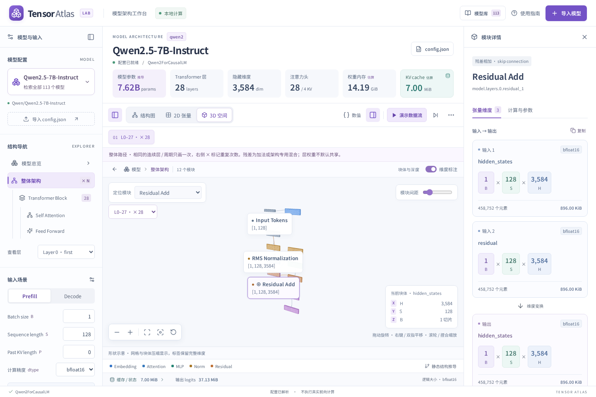

# 整体架构与重复结构

原总览用一个 Transformer Blocks 卡片概括全部层，残差只在单层视图中显示。新增「整体架构」把主干替换为真实适配器产生的代表层内部，保留总览的输入、嵌入、输出及辅助分支。它遵守原模型适配范围，不意味着额外实现了未知算子或实际推理。

## 残差表达

- 普通 Attention / MLP 残差以独立合并节点、两路输入和橙色虚线旁路展示。并行残差保留三路输入。只补充视觉标识和缺失的输入说明，不为普通加法添加可训练参数。
- Gemma 单层的 PLE Gated Injection 拆为信号变换与 PLE Residual Add，显示 attention、MLP、PLE 三条残差。整体图中的 PLE 切片来源连接到对应代表层。
- DeepSeek 的 mHC 合并仍使用门控与混合矩阵；通用特殊主干也保留专用残差说明，不能把它们都解释为简单 `x + f(x)`。

## 折叠规则

只折叠连续重复的结构或完整重复周期，不把远处的同类层重新分组。相同的判断包含适配器已记录的注意力类型、窗口、头维度、KV 来源、专家结构和残差差异。比如 `A A A B A A A B` 显示 `[A ×3 → B] ×2`，不会改成 `A ×6 → B ×2`。

周期搜索上限为 64 层；超过这个上限的复杂周期保持更多分组，不改变原顺序或层数。每段 `period × repeat = length`，所有区段覆盖每个主干层且不重叠。循环模型另有外层重复框，标明跨轮共享权重。

结构图与 2D 的分组框是装饰，不是执行节点，不参与参数或播放累计。3D 用代表模块和「定位重复结构」显示相同区段。播放遍历折叠后的代表图，不逐次模拟所有重复层；顶部模型参数和 KV 仍由完整配置计算。

节点详情是代表层的实际配置和维度，重复模块的权重默认各层独立。点击代表层边界可进入单层视图，再通过层选择器检查具体层。导出包含 `architectureSections`、原层起点、周期、次数和长度。

## 验证

结构测试遍历统一库全部 111 个模型：重复还原后的顺序与原层签名一致、层数覆盖完整、连线端点和拓扑合法、维度形状有效。另检查普通双残差、并行残差、Gemma PLE 与 CED 分区边界。

浏览器检查整体入口、×28 代表层、×12 混合周期、残差详情、子模块展开、手机布局，以及结构图 / 2D / 3D 切换。单层和其他视图沿用原有回归测试。

长图在有限屏幕下仍需通过阶段导航、聚焦和专注模式阅读。分组框展示结构次数，不是按真实激活大小绘制，也不表示推理时显存占用。

