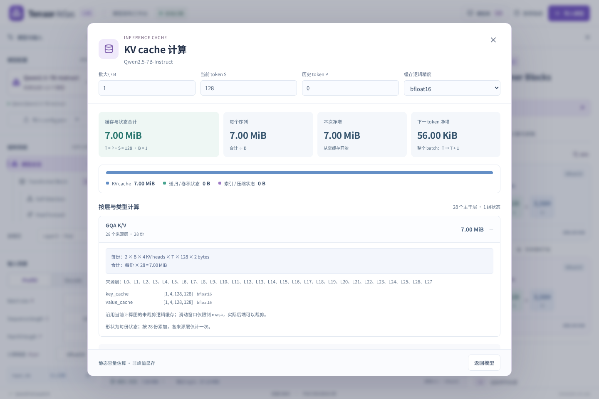
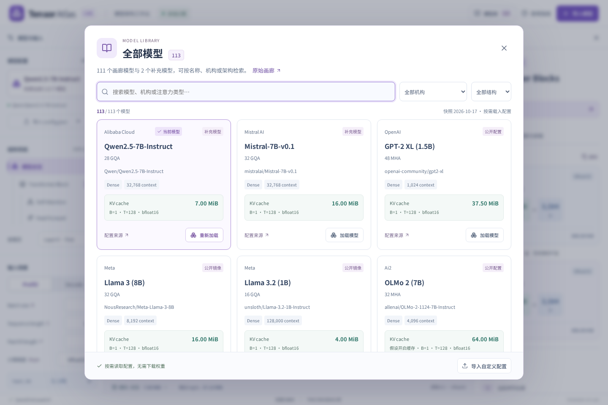

# 每模型 KV cache 与推理状态计算

统一模型库 111 个条目（包含 Qwen3 Base / 对话版等配置版本）均接入缓存汇总。入口包括模型摘要的 KV cache、底部缓存与状态合计、模型库中的卡片预览。三种画布共用同一份场景与报告，导出的 JSON 含 `cache` 字段、原始 bytes、公式、来源层与范围说明。

## 字段语义

| 字段            | 含义                                                            |
| --------------- | --------------------------------------------------------------- |
| KV cache        | 保存历史注意力 K/V 或对应 latent 的容量；不混入递归状态         |
| 递归 / 卷积状态 | Mamba、DeltaNet、KDA、mLSTM 等保存历史信息的固定形状状态        |
| 索引 / 压缩状态 | DeepSeek V4.1 索引 K 与未完成压缩组的缓冲                       |
| 合计 / 已知小计 | 三类已知状态的和；专用或未完整覆盖架构明确标记部分估算          |
| 每序列          | 合计除以 B；假设 batch 中各序列等长、无共享前缀                 |
| 本次净增        | `cache(P+S) − cache(P)`；P=0 时从空缓存开始，包含固定状态初始化 |
| 下一 token 净增 | 当前整个 batch 的 `cache(T+1) − cache(T)`；每序列追加一个 token |

T=P+S。B / S / P / dtype 可以在弹窗内实时调整；沿用模型的场景校验，例如 DeepSeek V4.1 缓存解码 S=1。修改精度也会更新工作台的逻辑 dtype。权重的量化格式不会自动改写 KV 精度。

## 各类架构口径

- **MHA / GQA / MQA**：`2 × L × B × Nkv × T × D × bytes`，其中 2 表示 K 和 V；使用实际 `head_dim` 和 KV heads。Qwen3 的显式 head_dim 不从 hidden_size / heads 反推。
- **原 Llama / Qwen / Mistral 专用图**：保持已有未裁剪的逻辑 KV 表示；滑动窗口作用于 mask，明细提示实际后端可以裁剪。
- **Gemma E2B / E4B**：按每个独立来源层计算，局部与全局使用不同 head_dim；共享消费者不增加持久副本。局部持久缓存上限 W−1，完整共享张量或本次 attention 可见键长度不当作额外持久状态。
- **画廊通用主干**：逐层使用 `catalogState` 的实际头数、K/V 宽度、窗口、压缩率、重复子层和循环次数。逻辑窗口通常使用 `min(T,W)`；不同后端可有 W−1、预分配或其他物理布局，不统一宣称是 Transformers DynamicCache 的实际显存。
- **MLA / DSA / GDLA**：采用适配器的吸收投影 latent 表示，MLA 的 rotary key 单列；不重复乘 K/V 的 2。保存展开 K/V 的后端不适用该紧凑逻辑量。
- **递归和混合主干**：K/V 与固定递归状态分开。标为 FP32 的矩阵 / SSM 状态始终按 4 bytes，卷积状态按当前 dtype。纯递归模型传统 KV=0 不表示全部推理状态为零。
- **DeepSeek V4.1**：各层有效 SWA latent + 唯一来源全局 latent 作为 KV；索引 K、FP32 kv_state / score_state 单独计入辅助状态。全局条目数为 `floor(T/r)`，所以单 token 增量随压缩边界变化。全局 FP4 紧凑估算含 scales，作为浮点全局缓存的替代格式单列，不重复相加；不包含 SWA、DSpark、Engram 历史、候选索引和工作区。

`use_cache=false` 明确提示是假设开启缓存后的理论容量。未知算子不返回“确定无缓存”，而记录未知层并显示已知部分。上下文超限时给出外推提示，不能据容量数字推断模型支持该长度。这里不计张量并行 padding、分页对齐、beam expansion、前缀共享、预分配空位或峰值工作区。

## 例子与验证

Qwen2.5 7B 默认 B=1、S=128、P=0、BF16：`2 × 28 × 1 × 4 × 128 × 128 × 2 = 7,340,032 bytes = 7 MiB`，下一 token 净增 56 KiB。BF16 / FP16 均为 2 bytes；FP32 为 4 bytes。

测试覆盖全部 111 个条目和配置版本，汇总与原缓存估算一致；另有独立数值检查覆盖 GQA、非标准 head_dim、共享来源、窗口饱和、MLA、混合 FP32 状态、纯递归、压缩边界及空缓存初始化。浏览器检查弹窗编辑与同步、模型库预览、导出、移动端以及专用架构。

通用缓存策略参考 [Transformers KV cache 文档](https://huggingface.co/docs/transformers/main/en/kv_cache)；Gemma 共享和滑动规则沿用 [Gemma 适配来源](../gemma/README.md)，CED / FP4 沿用 [DeepSeek 固定版本来源](../deepseek/README.md)。

