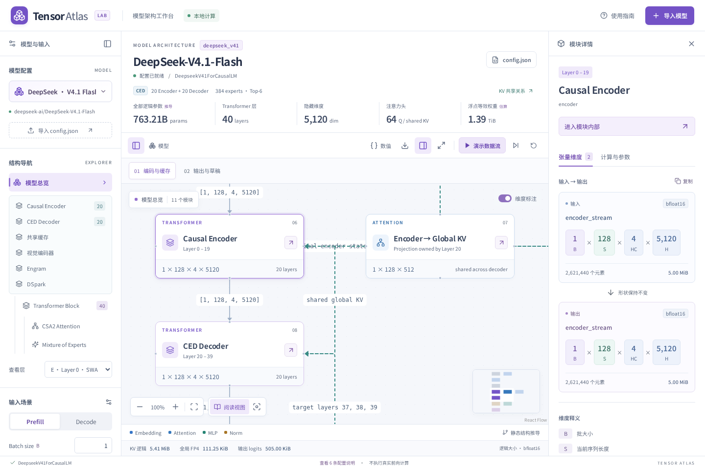
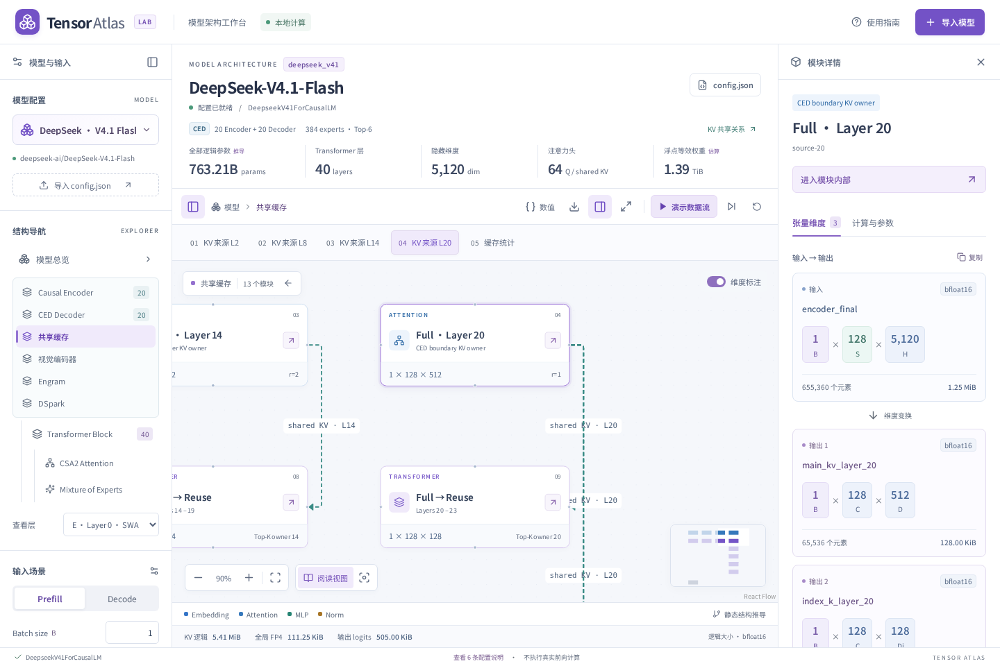

# DeepSeek V4.1 Flash 适配

此适配是**配置驱动的静态结构与维度展示**，无需下载权重。它不执行模型推理、不生成真实路由结果、不测量峰值显存，也不泛化支持所有 encoder-decoder 模型。

## 参考版本

配置、参考 Python 代码及技术报告固定到官方 Hugging Face 仓库提交 `314113f8a7dadb388215396ba5fbee2c610a04d6`：

- [config.json](https://huggingface.co/deepseek-ai/DeepSeek-V4.1-Flash/blob/314113f8a7dadb388215396ba5fbee2c610a04d6/config.json)
- [模型说明](https://huggingface.co/deepseek-ai/DeepSeek-V4.1-Flash/blob/314113f8a7dadb388215396ba5fbee2c610a04d6/README.md)
- [语言模型参考实现](https://huggingface.co/deepseek-ai/DeepSeek-V4.1-Flash/blob/314113f8a7dadb388215396ba5fbee2c610a04d6/inference/model.py)
- [视觉实现](https://huggingface.co/deepseek-ai/DeepSeek-V4.1-Flash/blob/314113f8a7dadb388215396ba5fbee2c610a04d6/inference/vision.py)、[图像预处理](https://huggingface.co/deepseek-ai/DeepSeek-V4.1-Flash/blob/314113f8a7dadb388215396ba5fbee2c610a04d6/inference/image_processor.py)
- [技术报告](https://huggingface.co/deepseek-ai/DeepSeek-V4.1-Flash/blob/314113f8a7dadb388215396ba5fbee2c610a04d6/DeepSeek_V41_Tech_Report.pdf)，§2.2、§2.3、§3.2.2、§4.2.1

## 支持的图

| 视图              | 展示内容                                                                                           |
| ----------------- | -------------------------------------------------------------------------------------------------- |
| 总览              | 视觉/文字合并、mHC 扩展、20 层 Encoder、边界全局 KV、20 层 Decoder、LM Head、Engram、DSpark        |
| Encoder / Decoder | 按连续相同模式折叠层组，可进入首层或精确选择其他层                                                 |
| 层内部            | Engram 注入（如有）、mHC pre/post、RMSNorm、CSA2、MoE、残差及下一子层 pre-mix                      |
| CSA2              | Query 低秩投影、本地 SWA、全局 KV/索引 K、Top-K 复用、候选池、稀疏 attention sink、分组输出投影    |
| 共享缓存          | 按 KV 来源层列消费者与 Top-K 来源；入口可直达真实层；独立缓存统计节点                              |
| MoE               | correction bias / router、Top-K、逻辑 dispatch 槽位、专家 SwiGLU、共享专家、加权合并               |
| 视觉              | 单图 patch → ViT → final norm → pixel-unshuffle（含补零）→ GELU projector → image span 插入        |
| Engram            | token n-gram 哈希形状、嵌入表、HC keys / shared value、门控注入                                    |
| DSpark            | 目标层 attention 输入采样、main projection、noise block、草稿层、共享 LM Head + Markov、confidence |

## CED 与共享缓存

层编号使用 0-based：Encoder 0–19，Decoder 20–39。`ForCausalLM` 是任务头名称，不能据此推断内部是普通 decoder-only。

- SWA：0、1。
- Full：2、8、14、20。产生全局 main KV 与 index K，且计算 Top-K。
- Reindex：24、28、32、36。复用 Layer 20 的 KV / index K，重新计算 Top-K。
- Reuse：其余层。复用最近 Full 的 KV 及最近 Full/Reindex 的 Top-K。
- Encoder 全局压缩比为 2；Decoder 为 1。Decoder 首个 Full 从 Encoder 最终隐藏状态投影全局 KV；所有 Decoder 仍自行计算本地 SWA KV。

完整前向模式跟随可读参考实现，每次 token 在所有主干层计算。有界重放模式依据技术报告：Prefill 主体止于 Encoder，Decoder SWA 仅重放末尾 `window` 个 token，是近似的生产调度示意，**不是参考 Python 中实际执行的分支**。界面不会把它表示为已测量的速度提升。Decode 当前只支持 S=1。

## 张量与缓存公式

令 `T=P+S`，当前层查询长度为 `Q`。完整参考模式 `Q=S`；有界重放 Prefill 的 Decoder 为 `Q=min(S,window)`。

- mHC residual：`[B,Q,HC,H]`，官方 HC=4。
- Query rank：`[B,Q,Rq]`；Query：`[B,Q,Nq,D]`。
- 某来源层压缩全局 KV：`[B,floor(T/r),D]`；index K：`[B,floor(T/r),Di]`。
- 本次新增压缩条目：`floor((P+S)/r)-floor(P/r)`，未完成组不提前产生缓存条目。
- Top-K indices：`[B,Q,min(index_topk,floor(T/r))]`。Prefill 早期位置有不可见条目，以 -1 表示；具体索引值不可从配置推断。
- 图中 SWA 采用有效窗口 `W=min(T,window)`；参考实现实际预分配 `[B,window,D]` 环形张量，Decode 可能含尚未有效的槽位。SWA 逻辑分数展示有效候选宽度而非 kernel padding。
- Output LoRA：`[B,Q,G,Nq×D/G] → [B,Q,G,Ro] → [B,Q,H]`。
- 主干 LM Head 按参考生成路径只输出最后位置 `[B,V]` float32。DSpark logits 是 `[B,Ldraft,V]`。

**缓存统计**只计每个唯一来源一次，main KV 是 K/V 共用 latent，不乘 2。全局紧凑 FP4 每条目字节数：

```text
main KV: D / 2 + ceil(D / 16)       # FP4 data + 每 16 通道一个 E4M3 scale
index K: Di / 2 + ceil(Di / 32)     # FP4 data + 每 32 通道一个 E8M0 scale
```

官方配置 D=512、Di=128，每条目共 356 bytes。每 token 长期全局条目数为 `3/2+1=2.5`，因此偶数长度下全局缓存恰为 **890 bytes/token**，不含 SWA、压缩残留状态、候选池、临时索引分数、框架开销或 DSpark 窗口。

底部「KV 逻辑」是有效全局 KV + index K + 主干有效 SWA + compressor FP32 临时状态；浮点精度改变逻辑大小，不改变紧凑 FP4 估算。生产内核量化打包与参考 Python 在浮点张量上模拟量化的实际分配不同。

## 参数与权重范围

逻辑参数按权重元素计，不计量化 scales 或 tensor-parallel padding。各专家全量权重计入总量；激活的专家数量并不等于模型参数总量。

| 部分                                            |            参数 |
| ----------------------------------------------- | --------------: |
| CED 主干（含 embedding / LM head，不含 Engram） | 551,566,180,464 |
| Engram embedding / 投影 / gate                  | 196,928,504,320 |
| Vision + projector + 图像标记 embedding         |     485,268,480 |
| DSpark 独立权重（共享 embedding/head 只计一次） |  14,225,362,530 |
| 合计                                            | 763,205,315,794 |

每层 MoE 是 384 routed + 1 shared experts、Top-6；实际专家 ID、每专家 token 数、动态负载与激活值未知。显示 `[B,Q,K,H]` 是逻辑路由槽位，不是宣称实际分配该大张量。

## 图像与条件分支

「包含图像」示例为每样本一张图。输入网格是已预处理的 patch 网格，不从原始图片长宽猜测 resize。默认 42×42 patches：1764 个 ViT token → 14×14=196 个视觉特征 → 包含每行 newline 和起止 token 的 **212 个图像 span token**。S 已包含这些位置，不额外相加。`max_image_tokens` 校验包含分隔 token。

未启用图像时视觉图显示示例形状，标记为当前不执行并从播放中跳过。DSpark 不属于主流程默认解码；其专用视图展示 forward_spec 结构，不模拟草稿接受率。原始配置的 43 个 `compress_ratios` 条目中，最后 3 个属于 DSpark，不被误算为 43 个主干层。

## 验证

- 单元测试覆盖非法配置、单独文本配置、四种模式、来源关系、压缩余数、bounded query/global KV 分离、FP4 scales、图像补零与 token 开销、全部视图 DAG、分层参数汇总。
- 浏览器测试覆盖官方嵌套 JSON 导入、精确选层、共享缓存跳转、Prefill/Decode 联动、视觉网格、MoE 与导出、切回 dense 模型。
- `scripts/verify-deepseek-reference.py` 可对本地下载的固定版 `inference/` 代码执行 meta-device 实例化核对参数。CUDA kernel 导入被替换为禁止执行的函数，仅验证模块声明，无权重下载。结果保存于 [reference-counts.json](reference-counts.json)。
- `scripts/verify-deepseek-shapes.py --reference-dir /path/to/inference` 以小尺寸配置运行了官方 Attention 的 24 次层前向（prefill + 两次 decode），用 CPU 逻辑稀疏注意力替代 CUDA/量化 kernel，核对了来源共享、Top-K 与缓存形状；视觉 ViT/Aligner 验证了不可整除 patch 网格补零。不把此检查当作真实 FP4 数值或 GPU 性能验证。




