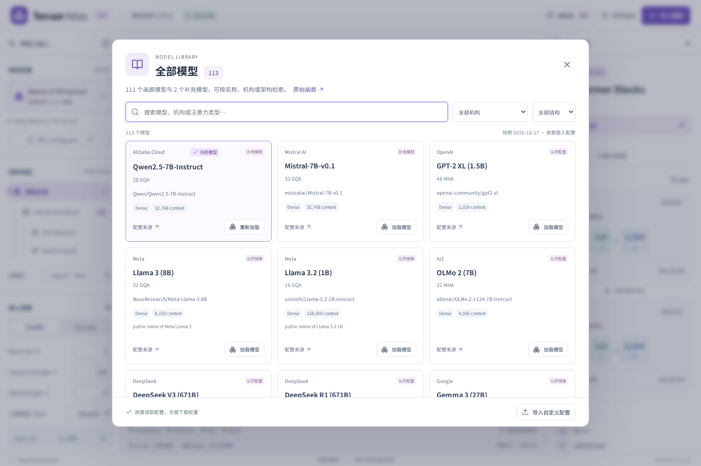
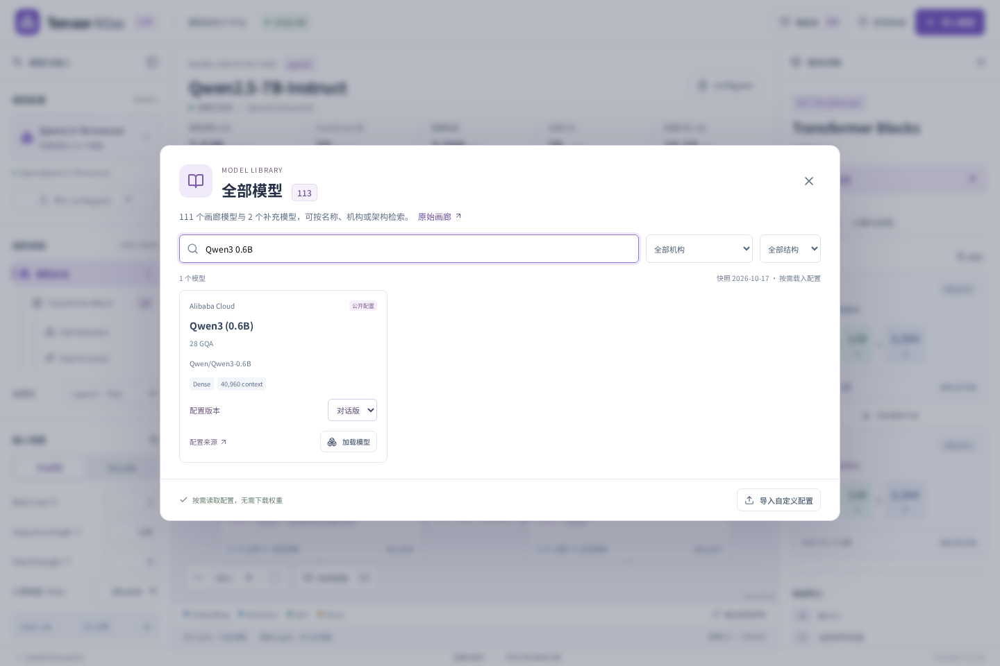
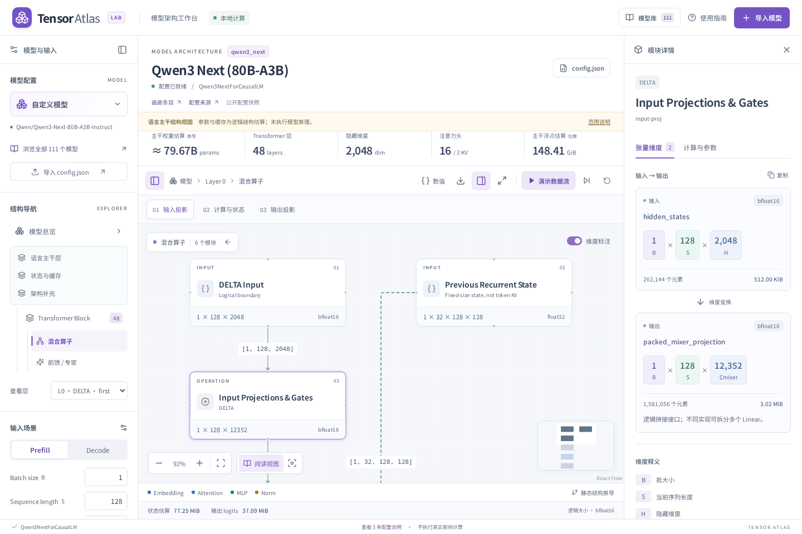

# Raschka Architecture Gallery 模型库

已收录指定页面在 **2026-10-17** 的 **111 个模型条目**。统一模型库仅包含这 **111 个画廊模型条目**，对应的快捷配置合并为卡片内的配置版本。点击左侧「模型配置」中的模型选择器或顶栏「模型库」，打开同一个窗口，搜索名称、仓库、机构、配置类型与注意力关键词，也可按机构及 Dense / MoE / 混合结构筛选。

原快捷配置中的 Llama 3.2 1B、DeepSeek V4.1 Flash、Gemma 4 E2B / E4B 已合并到对应画廊卡片。Qwen3 0.6B 也只显示一个条目，卡片内可选择 Base（32,768 上下文）或对话版（40,960 上下文），来源随版本更新。画廊之外的 Qwen2.5 7B Instruct、Mistral 7B v0.1 已移出模型库，仍可通过自定义导入使用。

模型库标记当前模型，加载后同步更新左侧名称、来源和可视化。搜索兼容大小写、全角字符和常见分隔符，并区分完整数字，如 20B 与 120B。窗口底部可导入自定义配置；自定义导入在侧栏单独标注，不误标为内置条目。

这次收录的范围与原画廊一致：**语言模型或多模态模型的语言主干**。它不是对所有媒体编码器、训练算法或推理后端的统一仿真。每个条目均可加载；已实现的专用适配继续保留，其他条目使用结构规则生成层图与逻辑接口。完整名单及来源见 [COVERAGE.md](COVERAGE.md)。

## 可视化范围

- 原有 Llama、Qwen dense、Gemma E2B/E4B、DeepSeek V4.1 使用原专用适配器；参数与形状仍由对应测试覆盖。
- 新增主干家族包括 GPT-2、OLMo、Gemma 3/4 大模型、Qwen MoE/Next/3.5+、GLM、Kimi、MiniMax、Mistral MLA、Llama 4、Nemotron、MiMo、Ling、LFM、xLSTM、Grok、Cohere、Granite、Step、Laguna、Sarvam 等。
- 展示 MHA/GQA、局部与全局混合注意力、MLA 潜在缓存、稀疏选择、DeltaNet/KDA、Mamba-2、短卷积、mLSTM 状态、MoE 与 LatentMoE、循环共享权重、CCA/GDLA 及 DeepSeek V4 CSA/HCA 的逻辑结构。
- 每个新主干有总览、逐层列表、混合算子、前馈/专家、状态/缓存和架构补充入口。选层后使用该层的 heads、K/V 宽度、混合类型、专家配置与窗口参数。
- **通用主干的参数栏明确显示结构估算。** 不是每个模型都经过逐权重验证；媒体编码器、MTP、ngram 表、专用 residual/indexer 参数等可能只列出配置与接口，不能把小计当成全模型精确参数。
- **状态估算不是峰值显存。** MLA 展示潜在缓存，朴素实现可能保留展开 K/V；稀疏索引器、重叠压缩组、内核临时空间和特殊算子辅助状态可能未计入，界面以「部分状态估算」标明。
- 对通用专用算子，内部动态路由/分块规则只展示公开配置与实现能确定的形状，不推断真实索引值、激活数值、性能或路由分布。不同模型的 gate/normalization/clipping 元数据保留在配置说明中。

## 已核对的代表主干

以下 14 个公开配置用 Transformers 5.12.1 在 PyTorch **meta device** 上实例化，并与本项目结构计数逐项比较：GPT-2 XL、OLMo 2 7B、OLMo 3 7B、Phi-4、SmolLM3、Qwen3 30B-A3B、GLM-4.5-Air、GPT-OSS 20B、DeepSeek V3、MiniMax M2、LFM2.5 350M、LFM2.5 8B-A1B、Qwen3-Next 80B-A3B、Nemotron 3 Nano 30B-A3B。

结果在 [reference-counts.json](reference-counts.json)。这证明指定参考主干的权重计数一致，不代表所有系列变体、辅助预测头或媒体分支均已核对。复核不下载真实权重：

```bash
python scripts/verify-gallery-reference.py
```

模型可能把部分声明层用于辅助预测、循环共享或多次 attention 子层。例如 LongCat 的 `num_layers` 是包含两次 MLA 的复合块，Step 配置可能包含主干之外的额外 `layer_types`。主图优先遵从已读取配置与实现语义；画廊的 layer mix 文本作为来源对照保留，不强行改写配置以匹配网页描述。

## 来源与例外

所有条目都有画廊链接和配置来源链接。`src/data/gallery-manifest.json` 保存原始卡片 ID、来源、配置提交 revision 和快照日期。这里不复制画廊图片、长段说明或付费图集，只使用模型名称、结构事实及来源链接，自行生成交互图。

- 多数配置直接来自官方公开仓库，固定到读取时的 commit SHA。
- Llama、部分 Gemma、Antares、Muse Spark 等受限配置使用公开镜像，在模型库标注。镜像不表示读取了官方受限内容。
- **Tiny Aya**：公开 GGUF 的结构元数据转换成可视化配置，局部/全局周期参考官方模型卡。不是原始 HF `config.json`。
- **Soofi S**：其官方模型卡明确声明采用 Nemotron 3 Nano 参考设计；使用 NVIDIA 参考结构，并按 Soofi 卡片修正共享专家信息。不是独立发布的 Soofi 配置，不承诺与未公开 checkpoint 全部字段一致。
- **BTL-3**：读取官方 `adapter_config.json`，解析其中的 `base_model_name_or_path`，使用 Qwen3.6-27B 基座结构；LoRA 权重及目标参数额外计数未纳入。
- **Ember-1**：按官方基座关系使用 Kimi K3 结构；未公开的派生差异不推测。
- **Mistral Large 3**：使用官方 `params.json` 映射其原生字段，原始文件保留。
- 大型 Nemotron 量化配置含数万条逐权重映射。可视化快照保留所有架构字段，并移除冗长的逐权重量化映射；原文件的固定版本链接和省略说明一起保存。这里不按省略后的配置加载权重。

## 性能与更新

模型库和配置按需动态导入，打开主页面不会一次解析全部模型。没有后台下载模型权重或执行 `trust_remote_code`，也不发送配置到推理服务。

本次页面清单是固定快照，不宣称自动包含网站未来新增条目。维护脚本默认仅检查本地清单与 SHA-256，不联网改动配置：

```bash
python scripts/refresh-gallery.py
# 可选：重新读取清单中固定版本的原始配置；派生和压缩快照保持不变
python scripts/refresh-gallery.py --fetch
```

快照校验结果：[snapshot-hashes.json](snapshot-hashes.json)。增添未来条目时应更新清单、配置与家族规则，再运行整库测试。未经支持的任意 `model_type` 仍会被拒绝，不能把所有 JSON 自动视作已验证架构。

## 验证

整库测试覆盖 111 个画廊条目的配置加载、全部语言主干视图、各类混合层、Decode 状态、图的无环依赖、有限整数维度与来源身份。统一目录另覆盖 111 个条目的去重、5 个快捷配置的合并、Qwen3 配置版本与精确型号检索。浏览器测试覆盖两个入口、当前模型标记、版本切换、自定义导入、搜索/筛选、加载、导出 provenance、派生来源提示、手机布局及原有适配器回归。






