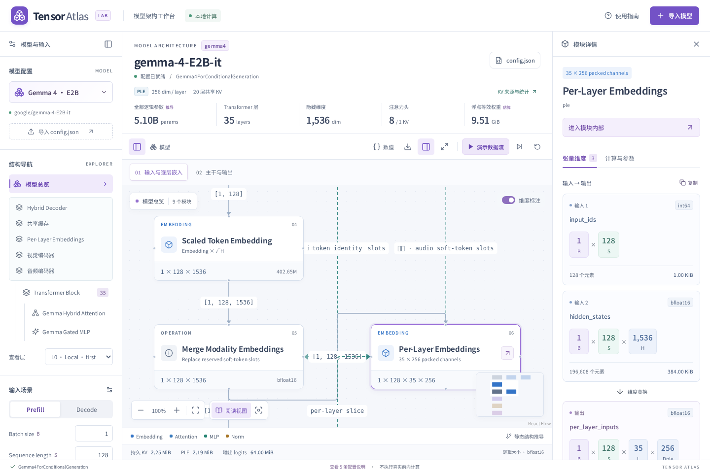
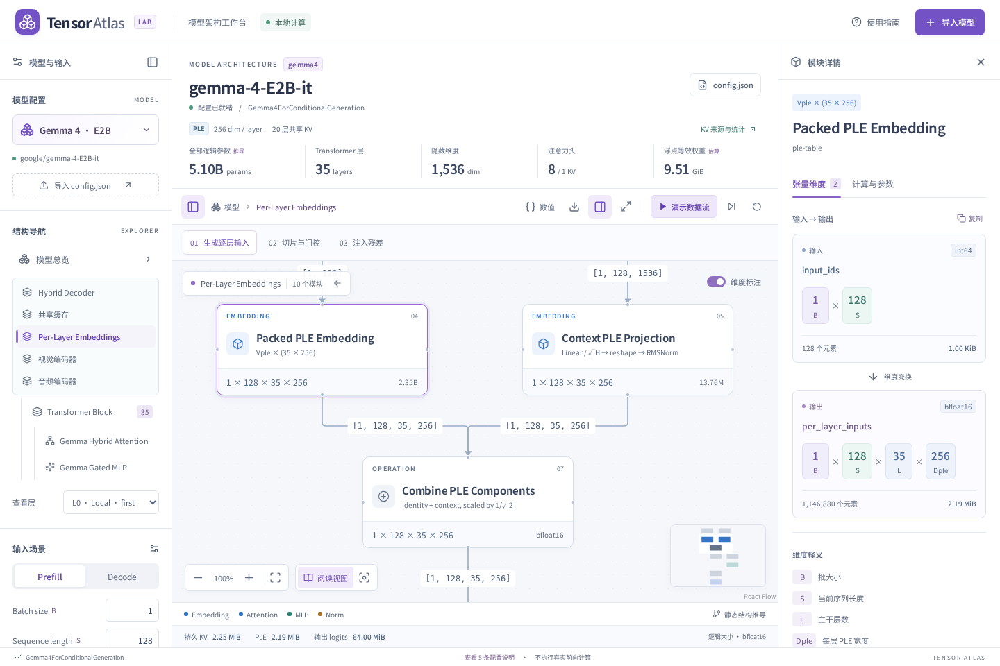

# Gemma 4 E2B / E4B 适配

支持官方 `gemma4` 嵌套配置（文本、视觉、音频）和单独 `gemma4_text` 配置。使用 **Gemma 4 · E2B** 或 **Gemma 4 · E4B** 示例即可离线探索，也可粘贴 JSON、上传文件或输入 Hugging Face 模型 ID。

本适配面向 E 系列的 dense + PLE 结构，不自动泛化到 Gemma 3/3n、Gemma 4 MoE、K=V 或无 PLE 变体。图示是静态形状与逻辑参数推导，不执行真实推理。

## 已支持

- 主干逐层导航、局部/全局混合注意力、逐层不同 head_dim。
- KV 共享来源、独立层与共享层权重差异、DynamicCache 持久长度与本次可见长度。
- 前后 RMSNorm、attention/MLP/PLE 三条残差、无参数 `layer_scalar`。
- PLE：token 查询大表、输入 embedding 投影、逐层切片、门控乘法及残差注入。
- E2B 共享层的 double-wide MLP；E4B 维持标准宽度。
- 视觉：patch + 二维位置 embedding、双向 Transformer、位置平均池化、有效 token 展平、语言空间映射。
- 音频：特征帧、两次 stride-2 卷积、分块相对位置 attention、轻量因果卷积、FFN 与 soft-token 映射。
- 当前层维度随 B/S/P/dtype、图像 patch 网格、音频特征帧实时更新；图像和音频可以同时启用。

## 关键差异

| 配置                    |                     E2B |             E4B |
| ----------------------- | ----------------------: | --------------: |
| 层数                    |                      35 |              42 |
| hidden_size             |                    1536 |            2560 |
| Query heads / KV heads  |                   8 / 1 |           8 / 2 |
| Local / Global head_dim |               256 / 512 |       256 / 512 |
| PLE dim / layer         |                     256 |             256 |
| 共享区起点（0-based）   |                      15 |              24 |
| Local KV 来源           |                      13 |              22 |
| Global KV 来源          |                      14 |              23 |
| 共享层 MLP 中间维度     | 12288（原 6144 的两倍） | 10240（不加宽） |

共享区按 attention 类型复用最后一个独立层的 **K 和 V**。共享层仍有 Q 投影、Q norm、O 投影，但没有 K/V 投影与 K norm。E 系列 `attention_k_eq_v=false`，不能套用其他 Gemma 4 变体的 K=V 规则。Attention scaling 为 **1.0**，不使用通用的 `1/√D`；Q/K 均有可训练 RMSNorm scale，V norm 无 scale。

局部 RoPE 旋转整个 head；全局 proportional RoPE 按官方配置旋转 25% 通道，即 128 维。语言主干为因果 Decoder；图像/音频有独立前端编码器，不采用 DeepSeek CED 的主干分区。

## 维度与缓存

- Query：`[B,Nq,S,D_layer]`。
- 完整 PLE：`[B,S,L,Dple]`，当前层切片 `[B,S,Dple]`。
- PLE 输入合成：`(RMSNorm(Linear(input_embeddings)/√H) + lookup(ids)×√Dple)/√2`。
- 层内 PLE 注入：`x + RMSNorm(project(GELU_tanh(gate(x)) × PLE_l))`。
- Global KV：本次可见和持久缓存均为 `P+S`。
- Local KV：本次可见长度 `min(P,W−1)+S`；调用结束后持久长度 `min(P+S,W−1)`，官方 W=512。
- 持久 KV 字节数：对**独立层**逐一累计 `2×B×Nkv×retained_length×D_layer×dtype_bytes`，共享层不增加缓存条目。

`shared_kv_states` 传递来源层本次可见状态。一次长 Prefill 中，可见 K/V 可能大于持久窗口；它们是引用，不是为每个消费者重新存一份。实现可能由于 tensor view、内存分配器、临时 attention 等因素保留额外内存，所以持久 KV 逻辑大小不等于实际峰值显存。

LM Head 展示默认 `logits_to_keep=0` 的全部 S 个位置，保持工作 dtype；再执行 `cap×tanh(logits/cap)`。权重与主 embedding 共享时只计一次。

## 参数验证

E2B/E4B 名称中的 E 是 effective 规模，不是完整权重总量。显示的参数总量与 Transformers 5.12.1 在 PyTorch meta device 上实例化的结果一致：

| 部分                                   |               E2B |               E4B |
| -------------------------------------- | ----------------: | ----------------: |
| 文本合计（含主 embedding、PLE 和主干） |     4,628,569,344 |     7,463,013,376 |
| 其中：主 embedding（与 LM Head 共享）  |       402,653,184 |       671,088,640 |
| 其中：PLE 表                           |     2,348,810,240 |     2,818,572,288 |
| 其中：PLE 输入投影 + norm              |        13,762,816 |        27,525,376 |
| 视觉（含语言映射）                     |       168,544,256 |       169,330,688 |
| 音频（含语言映射）                     |       307,183,904 |       308,756,768 |
| **全部参数**                           | **5,104,297,504** | **7,941,100,832** |

“其中”行已包含在文本合计，不能重复相加。模型内的 layer scalar、裁剪范围等 buffer 不计为可训练参数。内存估算使用所选浮点精度，不推断量化文件体积或有效运行参数。

完整分层参考结果：[E2B](reference-e2b.json)、[E4B](reference-e4b.json)。复现方式：

```bash
python scripts/verify-gemma-reference.py
python scripts/verify-gemma-reference.py --shapes
```

这两个命令不下载模型权重。第一步以 meta device 实例化完整配置并逐层核对参数；`--shapes` 使用小尺寸随机权重在 CPU 上执行文本 Prefill + 多 token Decode、PLE、共享缓存、视觉池化和音频编码前向，核对张量接口。Python 仅用于开发验证，网页运行无需 Python。

## 媒体场景的范围

每样本使用一张图片、一个音频片段，全部 patch/帧有效。图像输入是**预处理后的规则 patch 网格**，两边必须整除 pooling kernel。默认 42×60 patches，经 3×3 **平均池化**得到 280 soft tokens；加起止标记需要 282 个语言序列位置。它不是 DeepSeek 的 pixel-unshuffle：池化保持视觉通道数不变。

视觉池化缩放在 float32 执行，随后转回工作 dtype并筛选有效 token。官方接口合并 batch/token 轴为 `[Nvalid,Hv]`，当前全有效示例 `Nvalid=B×Nimg`，图中显式展示此步骤。多模态总览为方便理解，仍使用按样本分组的逻辑形状并附说明。

音频输入是预处理特征 `[B,F,Mel]`，不是原始波形；默认 128 个频率特征。两次卷积后 `Ta=ceil(ceil(F/2)/2)`。默认 F=128 得到 32 soft tokens，加起止标记需 34 个语言位置。音频图中的 FFN1 → Attention → Conv → FFN2 代表一个重复块，标注的参数合计覆盖全部音频层，不表示实际先执行所有 FFN1 再执行所有 Attention。

S 已包含所有媒体 soft tokens、起止标记和文本位置。实际 processor 的 resize、padding、音频裁剪、视频帧/时间戳布局不从 `config.json` 猜测。当前不提供视频时间轴、原始图片上传或原始音频解码。P>0 的 Decode 不重复执行媒体编码器，相关节点保留示例形状并标记为不执行、从播放中跳过。

## 固定参考来源

- [官方 E2B 配置](https://huggingface.co/google/gemma-4-E2B-it/blob/3e22461f65e89153144f8adb70e3b8c2cc9845a7/config.json)
- [官方 E4B 配置](https://huggingface.co/google/gemma-4-E4B-it/blob/ee0ef6023621cff504d758262d4e04895a5af4a2/config.json)
- [Gemma 4 模型说明](https://huggingface.co/google/gemma-4-E2B-it/blob/3e22461f65e89153144f8adb70e3b8c2cc9845a7/README.md)
- [Transformers 建模实现](https://github.com/huggingface/transformers/blob/d4804f9d76b8c071b993d813e9e87067b780cbee/src/transformers/models/gemma4/modeling_gemma4.py) 与 [配置定义](https://github.com/huggingface/transformers/blob/d4804f9d76b8c071b993d813e9e87067b780cbee/src/transformers/models/gemma4/configuration_gemma4.py)

结构参考固定提交；参数和小模型前向验证使用本地 Transformers 5.12.1，两者在本适配涉及的 E 系列参数、PLE、共享 KV、池化与音频形状上已核对。




