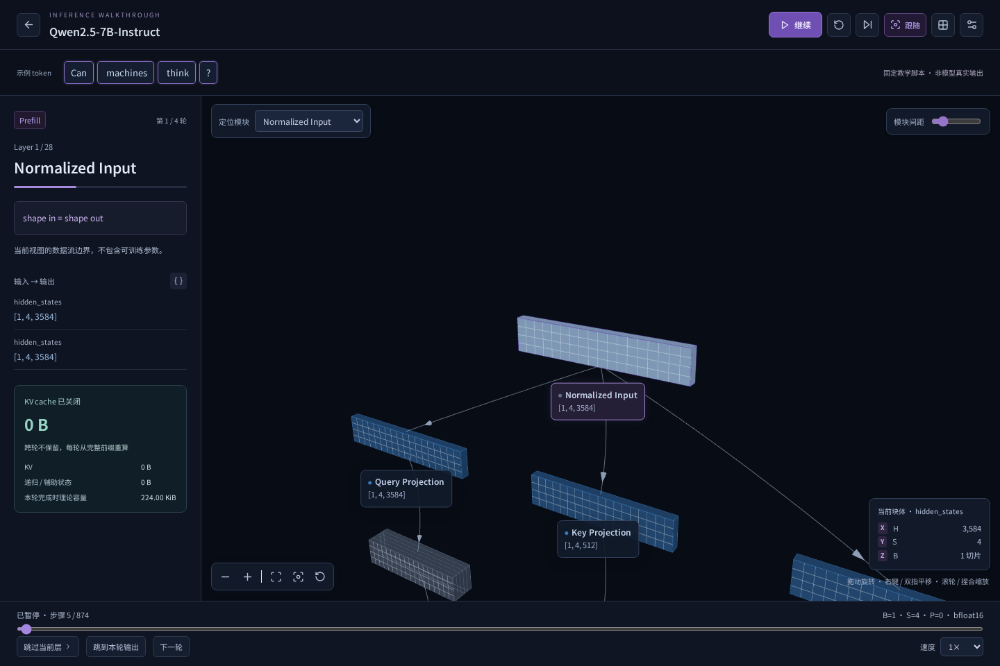
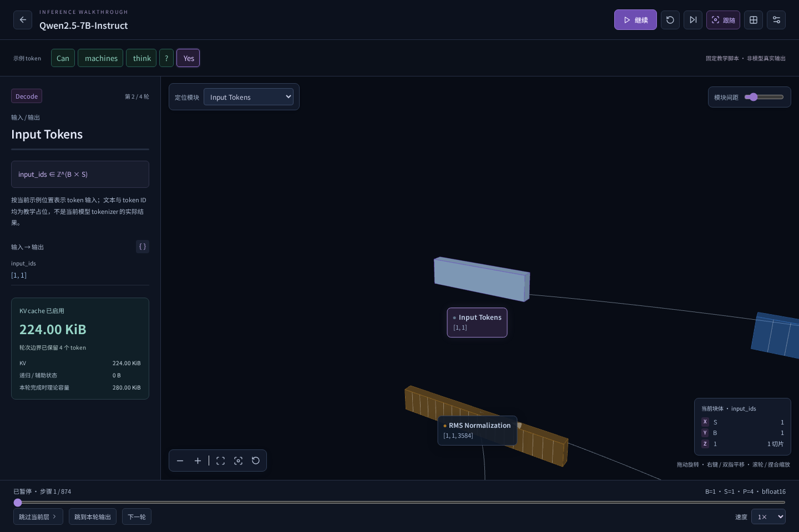
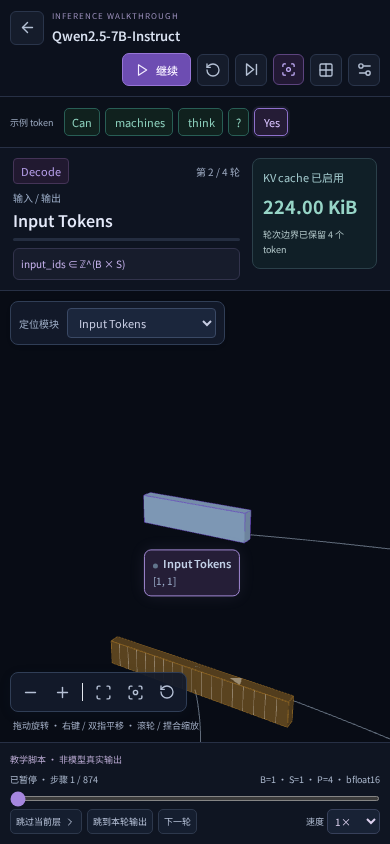

# 逐层示例推理演示

入口：选择模型 → 顶栏「示例推理」。独立工作区使用当前模型与 dtype；演示批大小为 1、输入是教学 token，退出不覆盖原工作台的 batch、序列、缓存长度或视图。

也可从普通 3D 视图点击「推理与详细解释」，或访问 `?demo=1&token=4&generation=0&kvCache=0`。2026-10-18 补齐稳定层级场景、完整组件侧栏、token / head 选择、矩阵分页、数学示例、公式 / 亮度设置及匹配运行记录导入，详见 [实际走查与差异说明](reference-review/REVIEW.md)。

## 与参考交互的对应

参考 [LLM-Visualized](https://www.llm-visualized.com/?token=4&generation=0&kvCache=0) 的公开界面：3D 张量块、逐步公式、输入与输出维度、提示 token、逐层播放、视角跟随、跳层与跳轮、速度调整、2D 切换和缓存模式。此实现使用本项目的模型适配器、场景布局与播放控制器，复用随项目分发的矩阵和向量图元，不依赖参考站点服务，也不复用其模型运行数据。图元来源见 [声明](../../src/vendor/llm-visualized/NOTICE.md)。

| 控制                                | 行为                                                       |
| ----------------------------------- | ---------------------------------------------------------- |
| 开始 / 暂停 / 继续                  | 保留步骤内部的进度；暂停停止推进和流动提示，继续从原处恢复 |
| 重新开始                            | 清空轮次、输出 token、步骤进度和演示缓存，从输入重新运行   |
| 下一步                              | 暂停并推进一个逻辑步骤，不启动后台播放                     |
| 跳过当前层 / 跳到本轮输出           | 暂停并定位目标；不等待整段动画                             |
| 下一轮                              | 完成本轮，追加一个脚本 token 并进入后续轮；最后一轮后停止  |
| 进度条 / 已输出 token               | 定位本轮步骤或回看指定生成轮；回看会同步截断后续教学输出   |
| 0.25× / 0.5× / 0.75× / 1× / 2× / 4× | 改变播放速率而不重置步骤                                   |
| 跟随                                | 跟随当前模块；关闭后可手动旋转、缩放和平移                 |
| 3D / 2D                             | 保留模型、轮次和步骤；WebGL 不可用可回退到 2D              |

键盘在画布上使用空格开始 / 暂停、R 重新开始。标签页进入后台自动暂停，需要主动继续。系统减少动态效果偏好禁用镜头过渡和流动标记。

默认「慢速讲解」按组件分配 4.2–8.2 秒停留：输入边界 4.2 秒、投影通常 5.2 秒、Embedding 6.2 秒、Norm 6.4 秒、Residual 7.4 秒、注意力 / softmax / 路由等重点步骤 8.2 秒。此时间是教学阅读预算，与真实模型性能无关。「连续浏览」使用约 48% 的时长；「逐步学习」每步完成后自动暂停。速度可以在任意位置改变，保留当前进度。暂停还保留 token 高亮和镜头位置。

动画在前段留出镜头与阅读时间，再展示输入流入、中段计算扫描和输出流出，末尾短暂停留。镜头不会在每次切换子视图时先适配全图再拉近；同一组内模块仍清晰可见时保持构图，必要时以约 0.7–1.25 秒平滑移到邻近计算区域。Q / K / V 等并行分支参与构图。完整模型的远景层结构被降低亮度，保留空间定位作用。[优化前后截图](polish/REVIEW.md)。

## 模型路径

完整逐层路线遍历所有实际主干层；默认代表层路线展示主要计算与异构边界，并明确标注省略步骤。层内 Attention 和 MLP 使用该层的专用图，返回层视图后执行残差合并。保持 MoE、局部 / 全局注意力、Gemma PLE / KV 共享、DeepSeek CED / mHC 和递归状态的原适配规则。循环主干按配置中的循环次数执行，权重计数不因播放次数重复累计。

默认提示为 `Can machines think?` 的 4 个教学位置；输出顺序来自固定脚本。长度变化时增加位置占位符。它们不是各模型 tokenizer 的实际分词，也不是模型生成的答案。只有带 LM Head 的模型有续写步骤；基础模型只输出隐藏状态。

若原适配器只提供专用算子的接口图，演示也只遍历该接口。媒体、DSpark、其他草稿和未展开辅助算子不纳入本次文本演示；不会把未知内部算子补成虚构执行数据。

## KV 与状态

开启缓存：第 0 轮 S=promptTokens、P=0；第 g>0 轮 S=1、P=promptTokens+g−1。关闭缓存：每轮 P=0、S=promptTokens+g，跨轮不保存状态。模型中的递归算子也沿用自己的状态规则，传统 KV 可以为 0 而其他状态非零。

侧栏容量在前向轮次边界更新，不冒充逐算子实际分配轨迹。采样步骤只追加输出 token；这个新 token 的 K/V 在下一次前向后才进入历史。分别显示当前保留状态与本轮结束后的理论容量，并继承原缓存计算的部分估算标记。

## 验证与边界

单元测试覆盖全部 111 个模型的 Prefill 与缓存 Decode 计划、实际层数和循环次数、节点映射与维度，以及开始 / 暂停 / 恢复 / 重启 / 结束状态、缓存边界、共享残差与无 LM Head 模型。

浏览器测试覆盖精确暂停、继续、重启、续写与回看、缓存模式、场景切换、手机设置及退出恢复。3D 渲染使用 Three.js，几何和事件在退出时释放；演示时间轴不代表模型运行耗时。

本功能是配置驱动的教学演示，不执行真实权重推理。可导入匹配模型的 token / 张量采样记录，以查看记录中的数值；未记录位置不补值。概率、完整权重矩阵、实际注意力热图仍需要对应运行数据。数学面板是独立教学例子；示意块体和流动标记不表示 GPU 任务。

默认代表层路线预计不超过 5 分钟（标准速度、默认两轮输出），可切换完整逐层；运行记录的 `instance`、张量轴和语义约束见 [模型语义与教学路线](../semantics/README.md)。
