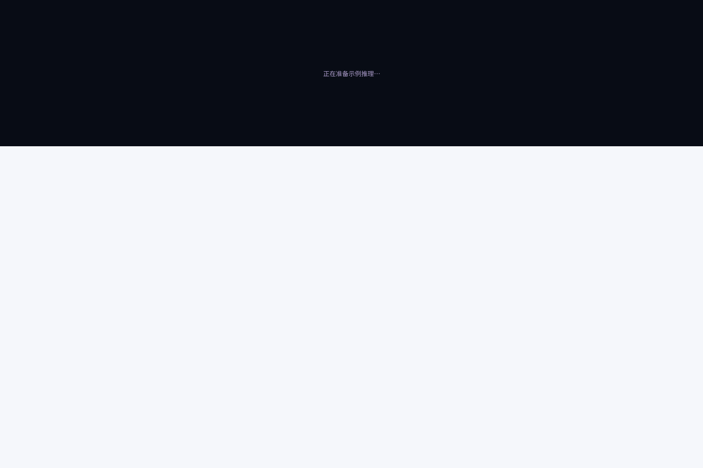
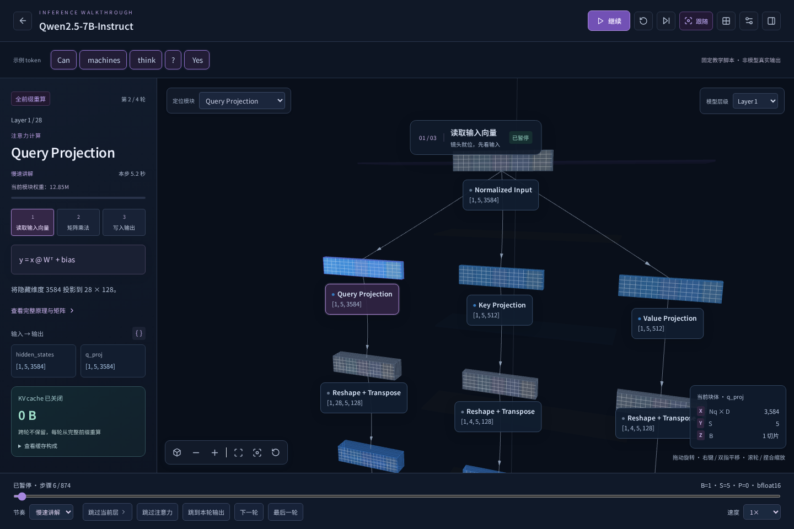
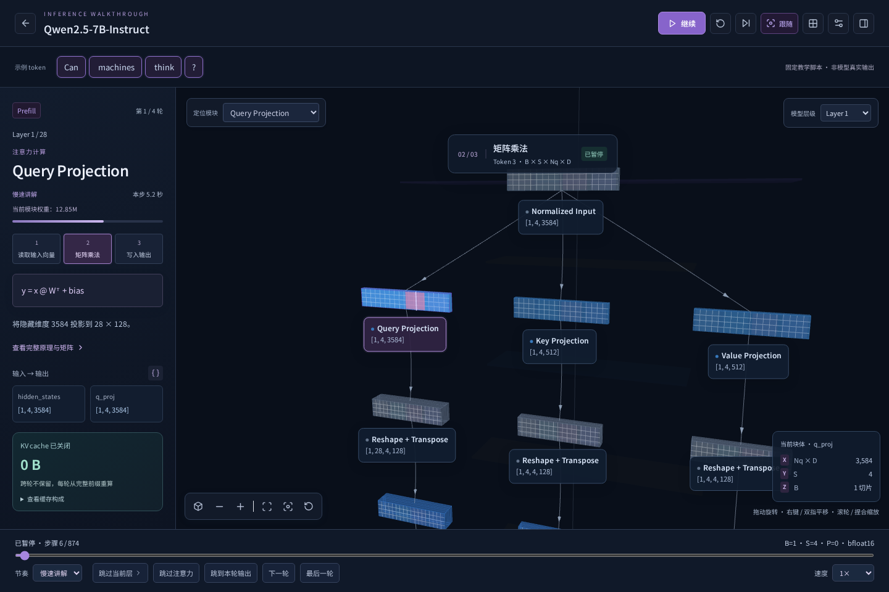
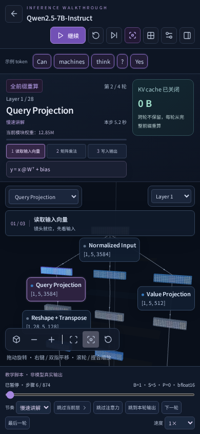

# 演示节奏与视觉优化

2026-10-18。根据实际演示和用户反馈，原方案有三个可定位的问题：所有步骤固定 900ms，侧栏来不及读；每次局部图切换都会先适配再拉近，镜头频繁跳动；多行 Attention 图被压缩到约 530 个布局单位内，使相邻算子过密。

## 已修改

| 原问题                           | 修改                                                                       |
| -------------------------------- | -------------------------------------------------------------------------- |
| 0.9 秒内同时切换模块、镜头和解释 | 默认慢速讲解按组件给出 4.2–8.2 秒；显示本步阅读时长                        |
| 缺少逐步理解方式                 | 新增逐步学习，每完成一个算子自动暂停；保留连续浏览和 0.25×–4× 调速         |
| 镜头每步拉远再拉近               | 只在初次显示时初始化；同组模块仍处于可读视区时保持镜头，必要时平滑移动     |
| QKV 分支被切断                   | 相关输入输出与同排同类分支一起参与构图                                     |
| 层内结构挤在一起                 | 显式保留至少 245 的行距、430 的列距；扩大层空间带，保留原拓扑与维度        |
| 只有一个光点循环                 | 分开输入传递、计算扫描、输出传递和结果停留；不把扫描线声称为实际矩阵元素   |
| 背景模型抢占注意力               | 远景雾化、背景层降低亮度和深度写入，标签优先展示当前区域                   |
| 解释与数字过于密集               | 加大标题、公式和正文，输入输出并列，缓存构成可展开，画面中增加当前阶段说明 |
| 暂停时 token 回到开头            | 从冻结的计算进度推导 token 高亮，继续和重启保持状态一致                    |

默认时长：输入 4.2s、常规算子 5.2s、Embedding 6.2s、Norm 6.4s、Residual 7.4s、Attention scores / Softmax / 路由等 8.2s、示例输出 7s。连续浏览使用 48% 时长，速度倍率再作除法。这些是教学设计值，不是模型推理计时。

进度 0–15% 为镜头与输入准备，15–33% 输入流动，33–76% 计算扫描，76–92% 输出传递，92–100% 结果停留。侧栏保留模型真实配置及张量维度；未导入的激活值仍不生成。

## 验证

新增独立测试检查时长策略、阶段切分、并行布局间距、默认慢速、精确暂停、0.25× 调速、逐步模式自动暂停和手机场景可见性。原有模型库、缓存、残差、3D、运行记录与播放回归继续验证。入口、暂停、完整详解和手机界面通过自动无障碍检查，结果见 [accessibility.json](accessibility.json)。

说明：长模型逐层讲解可能需要较长时间，保留跳层、跳轮和进度定位，不通过偷偷省略层来缩短播放。

[优化前](before.png) · [优化后](after-attention.png)

