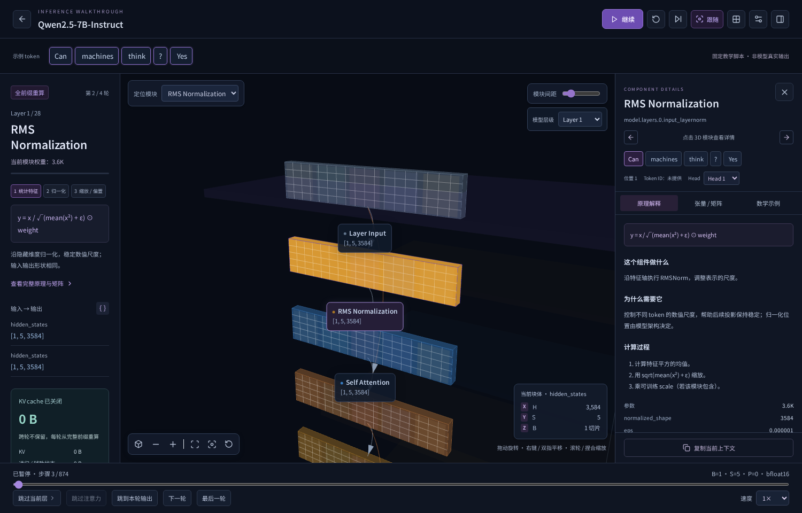
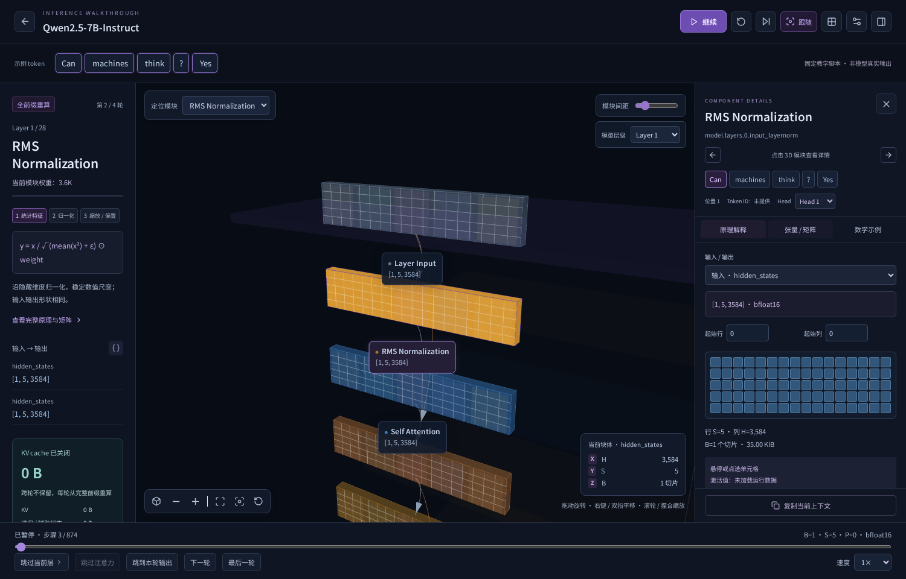
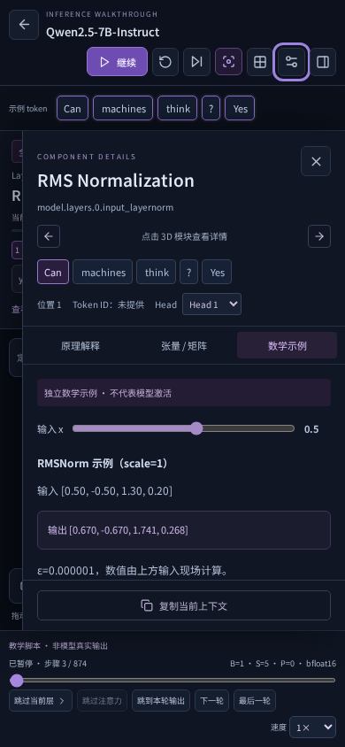

# 参考站点运行检查与交互补齐

2026-10-18，实际用 Chromium 打开并操作 [LLM-Visualized](https://www.llm-visualized.com/?token=4&generation=0&kvCache=0)，检查 3D 主场景、暂停、设置、token 详情、跳步菜单和 2D 页面；在 2D 中点选残差向量，确认侧栏会解释当前 token 在指定层入口处的含义。

## 确认的机制

参考页面使用全局模型场景、局部算子动画和可选择的组件详情。设置包含公式显示、KV cache、开发模式、速度和亮度。跳步区分当前层、注意力内部、当前前向结束、下一轮和最后一轮。

网络响应显示其加载 `capture.json`。文件包含固定提示 `Can machines think?`、token IDs、12 层 GPT‑2 激活采样、embedding / LayerNorm / QKV / Attention / MLP 字段与输出 logits。页面的激活颜色、矩阵数值和概率来自该模型的预录数据，不能从另一个模型的 config.json 推导出来。

本项目没有复制参考站点的长段说明、场景资源或激活数据。以下交互使用现有模型规则、独立说明和 Three.js 渲染实现。

## 本次补齐

- **稳定的整模空间**：所有主干层和其子结构作为背景保留；当前层的真实适配器图在固定空间带中展开，可进入模型全景或按层定位。长模型可通过定位控件访问，背景几何仅示意结构。
- **token 演示与子步骤**：颜色条标出本次 token 槽位；投影、归一化、残差和 softmax 显示三个教学子阶段，可暂停定位。不是实际内核时间线。
- **完整组件侧栏**：前后组件、token / head 选择、“做什么 / 为什么 / 计算过程”、公式、配置参数、输入输出及来源说明；长内容可键盘滚动。
- **矩阵浏览**：选择全部输入输出张量，移动起始行 / 列，悬停或点选位置查看值。未导入记录时明确没有激活值，不填入随机热图。
- **数学示例**：可调输入的 stable softmax、RMSNorm / LayerNorm、激活曲线和因果可见矩阵；全部标注为独立教学计算，不代表所选模型数值。
- **设置与控制**：公式开关、开发结构数据、场景亮度、跳过注意力、最后一轮；原开始 / 暂停 / 继续 / 重启、单步、进度条和缓存控制保留。
- **直接链接**：`?demo=1&token=4&generation=0&kvCache=0` 直接打开当前默认模型的演示。参数有长度和范围检查，退出时清除演示路由。
- **运行记录**：设置中下载当前模型的模板，填入实际运行产生的 token 和张量采样后导入。校验模型配置指纹、轮次、层、循环、张量形状、坐标、重复记录、有限值和体积上限。与模型不匹配的数据拒绝显示。

## 数值数据格式

模板格式 `version=1`，包括 `modelKey`、`source`、`settings`、`prompt`、`generated`、`samples`。模板本身仅是结构占位，必须由记录生成器填入真实 token、来源和采样值。最多 8 MiB、10,000 条张量记录和 250,000 个采样值。仅在本机浏览器读取，不发送远程请求。

每个 sample 指定 `pass / layer / loop / view / nodeId / direction / tensorIndex`，以及完整 `shape`、`indices` 和一一对应的 `values`。`loop` 缺省为 0。矩阵使用最后两轴，head 选择映射到对应头轴。未记录坐标保持“未记录”。配置指纹用于识别匹配配置，不是来源真实性认证；导入数据的可靠性取决于记录生成者。

## 明确的差异

本次补齐的是可复用到 113 个模型的交互与解释流程，并非参考站点逐像素、逐帧或逐数值的完全复制。参考站点的 GPT‑2 特定数值、全部预制物体动画、概率展示与媒体/特殊算子内核不能自动移植给所有模型。当前没有真实权重执行器；真实数值需要匹配的运行记录。层背景是结构摘要，当前局部图仍继承原适配器的范围限制。

完整回归：903 项单元测试、57 项浏览器测试；新增测试覆盖所有模型的稳定坐标和解释、数学运算、记录校验、直接路由、矩阵交互、设置与手机布局。后续收尾对矩阵分页和全景按钮另做定向回归。无障碍结果见 [accessibility.json](accessibility.json)。

