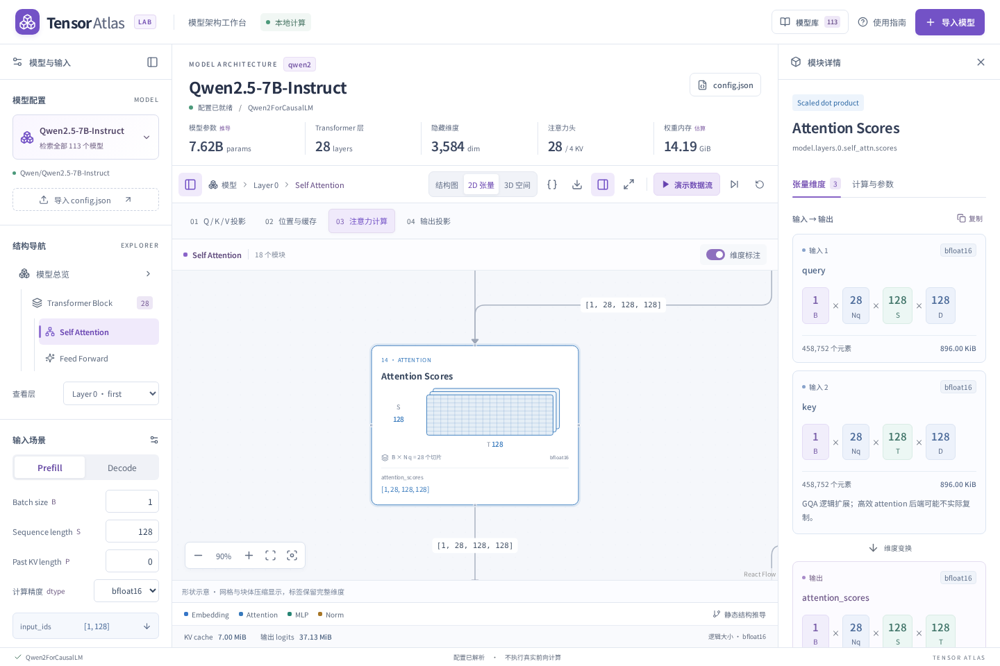
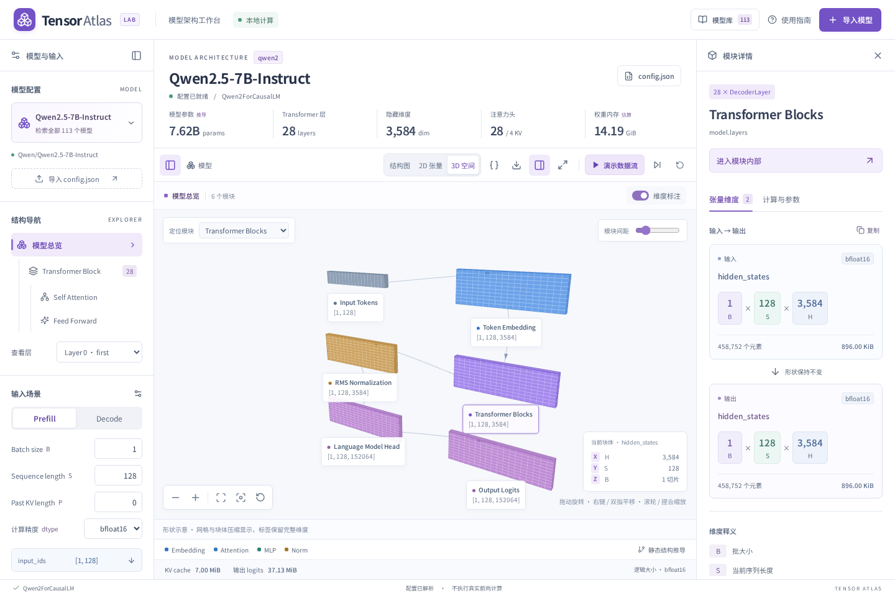
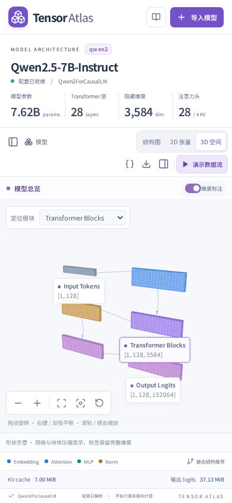

# 2D / 3D 张量视图

三种视图共用 `buildGraph` 产生的节点、张量与连线。2D 使用张量平面示意，3D 复用本地分发的矩阵、向量图元，并由当前模型配置驱动。图元来源见 [声明](../../src/vendor/llm-visualized/NOTICE.md)；各架构现有的推导语义保持一致。

## 张量如何显示

例如注意力分数 `[B, Nq, S, T] = [2, 28, 7, 20]`，2D 展示 7 行、20 列的平面和 56 个切片的标签；3D 使用注意力图元表示头与 token 的关系。网格和几何经过压缩以保持可读性，标签和详情保留完整张量维度；示意单元不与全部实际数值一一对应。

每个模块默认展示首个输出；多个输出可在右侧详情全部查看。块体之间的连接来自原计算图；残差连线保留。点击块体或标签会选中模块并聚焦，双击可展开具有内部结构的模块。长层列表可用「定位模块」和原侧栏的层导航。

## 验证

- 覆盖全部 111 个画廊条目的总览、注意力和前馈视图，验证节点身份、连线端点、形状和有限几何坐标。
- 覆盖高维切片、标量、向量、空缓存及大型张量的几何上限。
- 浏览器验证模式切换、Decode 维度、符号标签、2D 连线详情、3D 射线点选、旋转、缩放、模块展开、播放和模型切换。
- 浏览器验证手机抽屉、按需加载、反复切换时释放画布、WebGL 不可用时返回 2D。3D 测试用 Chromium 的软件 WebGL；不同 GPU 上的像素表现可能不同。

## 性能与范围

3D 依赖和两个渲染器按需导入。WebGL 没有空闲时的持续动画循环，场景改变和相机操作才重绘；几何资源、事件与画布在退出时释放。视图切换保留配置和输入场景，相机在重新进入时定位当前图，不持久保存手动相机角度。

本功能是配置驱动的静态结构可视化。播放只表示模块遍历，不执行前向推理、不下载权重，也不生成真实 token 或激活值。继承原架构适配器的所有范围说明。

