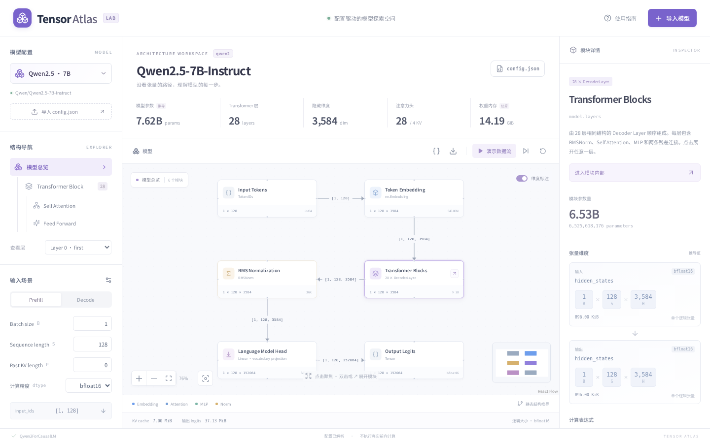
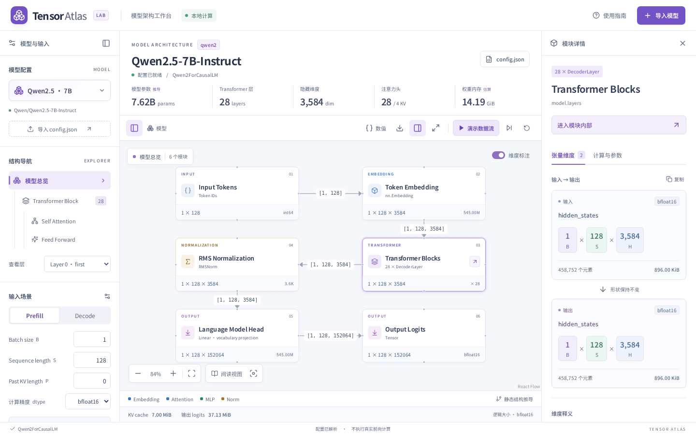
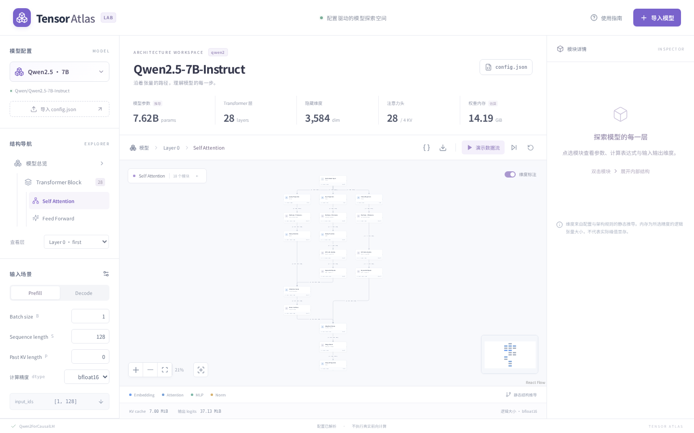
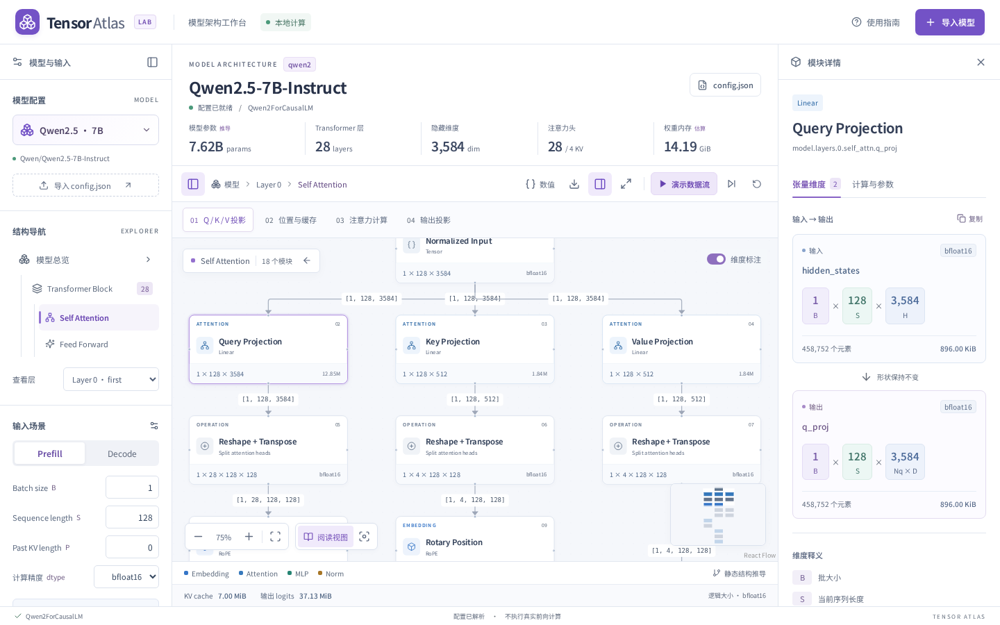
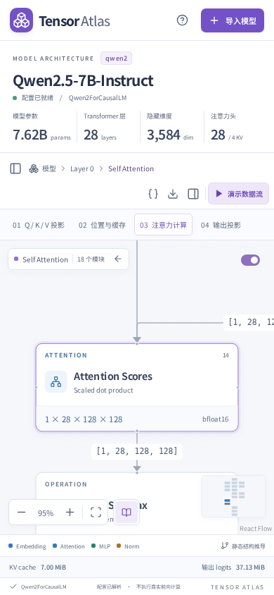
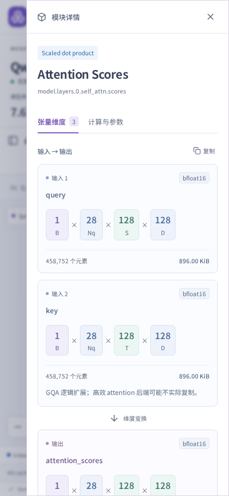

# Tensor Atlas UI 深度评审与优化

评审日期：2026-10-17。基于运行中的网页、实际浏览器截图和交互检查；桌面对比基准为 1440 × 900，默认 Qwen2.5-7B 配置。

## 结论

原版已有完整功能，但显示密度与信息优先级妨碍了探索：文字偏小、颜色过浅；长计算图为了完整展示被缩成缩略图；维度信息在详情面板中出现过晚。此次优化以「看清结构 → 选择模块 → 理解输入输出 → 深入计算」为主路径，保留原有配置与计算规则。

## 发现与已落实的改动

| 优先级 | 原问题与证据                                            | 改动                                                                       | 效果与边界                                                                                               |
| ------ | ------------------------------------------------------- | -------------------------------------------------------------------------- | -------------------------------------------------------------------------------------------------------- |
| P0     | Attention 全图默认缩放约 21%，12px 标题实际只剩约 2.6px | 阅读视图与全图预览分开；按投影、位置与缓存、注意力计算、输出四个阶段定位   | 默认投影阶段约 75%，保留三条并行分支；单击仍可放大到约 105%。窄屏按阶段锚点聚焦，完整图通过拖动/缩放探索 |
| P0     | 节点标题 12px，形状 9px，次要文本对比偏低               | 标题提高到 15px，形状提高到 12px；加深主次文本，按语义统一色彩             | 阅读比例下更易辨认。全图预览仍允许缩小；低于 65% 时显示放大阅读入口                                      |
| P1     | 固定三栏压缩复杂图，标题与指标占用过多高度              | 压缩模型摘要，支持收起左右面板、专注模式及 Escape 返回                     | 默认桌面画布高度从约 469px 增至 517px，提升约 10%；专注模式进一步释放侧栏与摘要空间                      |
| P1     | 参数量和说明先于张量，核心信息需要向下滚动              | 默认「张量维度」页签；「计算与参数」单独展示解释、公式和配置               | 输入输出更早出现；同形状张量明确标示形状不变                                                             |
| P1     | B / S / H 等符号没有就地解释                            | 维度卡片按批次、序列、特征维度配色，增加符号释义、元素数和复制             | 颜色之外始终保留符号与文本含义，复制的是当前真实维度                                                     |
| P1     | 改变窗口、收起面板和主动缩放可能触发视角跳动            | 区分自动适配和手动视角，保留选中节点作为焦点；取消会覆盖用户操作的延迟适配 | 用户手动缩放优先。明确切换阶段或画布尺寸变化才重新适配；100% 按钮确实设为 100%                           |
| P1     | 手机上配置、画布和详情串成很长页面                      | 首屏保留画布；模型配置与详情改为原生模态抽屉                               | 焦点约束、Escape 关闭与返回；选择内部视图后关闭配置抽屉。手机不要求在同屏看完整长图                      |
| P2     | 进入模块不明显，节点缺少扫描线索                        | 节点增加类型标签、顺序号、清晰的展开按钮；悬停高亮相邻连线                 | 用标签、边框、序号和颜色共同表达状态                                                                     |
| P2     | 播放时当前节点容易移出视野                              | 增加可关闭的视角跟随；保留暂停、单步和重置                                 | 减少动态效果的系统偏好会禁用镜头过渡和流动连线                                                           |
| P2     | 浮动控件与小地图可能遮住总览输出节点                    | 图适配预留上下控件空间；总览全图时隐藏重复的小地图                         | 阅读/长图仍显示可交互小地图；缩略预览与主画布各有用途                                                    |
| P2     | 按钮视觉文案与辅助名称不一致，页签键盘操作不完整        | 修正动态无障碍名称，补齐页签方向键/Home/End、可见焦点与节点 Enter 选择     | 自动检查覆盖五个主要界面状态；不等同完整无障碍认证                                                       |

## 截图

### 总览

改前：

改后：

### Attention 可读性

改前（约 21%）：

改后（投影阶段，约 75%）：

[注意力计算阶段](after-attention-stage.png) · [专注模式](after-focus.png) · [计算与参数](after-details.png) · [导入弹窗](after-import.png)

### 手机

## 验证

- TypeScript 与生产构建通过。
- 原有 52 项配置、维度、参数量和图拓扑测试通过。
- 10 项浏览器测试通过，包含原有导入和导出路径，以及新增的分段定位、面板切换后聚焦、键盘页签、复制、专注模式、手机抽屉、精确 100% 缩放与减少动态效果。
- 检查 1440×900、1280×800、1024×768、768×1024、390×844、360×740 六种尺寸，未发现页面横向溢出；首屏保留画布。
- 使用 axe-core 对总览、参数详情、Attention、导入弹窗、手机详情抽屉检查 WCAG 2 A/AA 和 2.1 A/AA 自动规则，最终均无自动检出的违规，详见 [结果](accessibility.json)。仍需人工辅助技术验证，尤其是复杂交互图的阅读顺序。

## 保留的设计取舍

长计算图的「全图可见」与「每个字清晰」无法在有限屏幕内同时保证。因此保留全图作为定位方式，阅读视图用于局部理解。当前没有增添实际推理、注意力热图或新模型架构；这些涉及数据和计算能力，应单独设计。

若后续增加模型对比或实际激活数据，建议先引入明确的比较模式/运行记录，再扩展详情信息，避免把所有数据继续堆到主画布。
