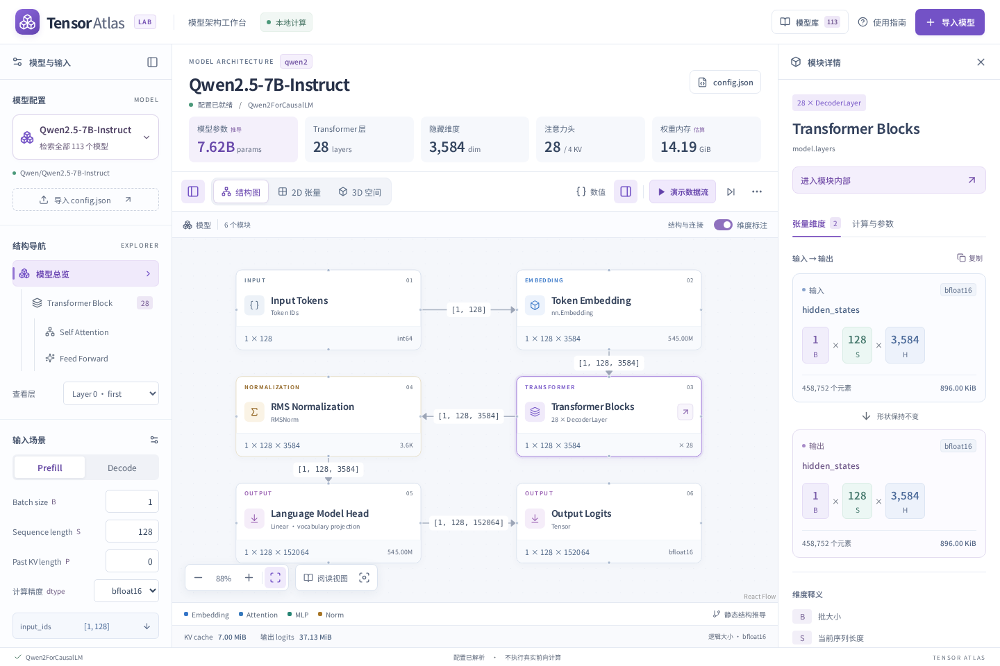
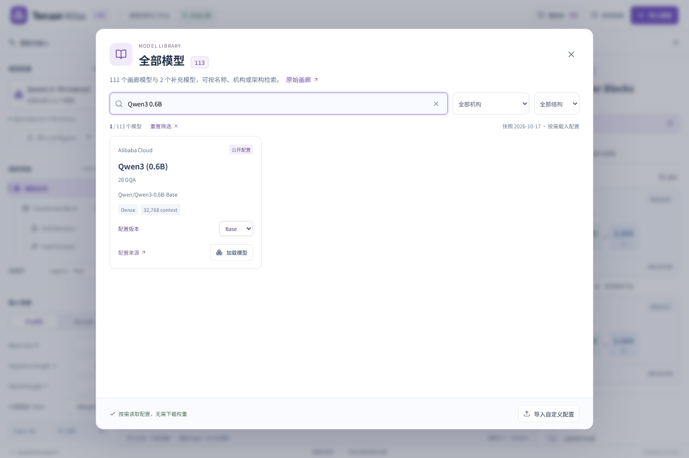
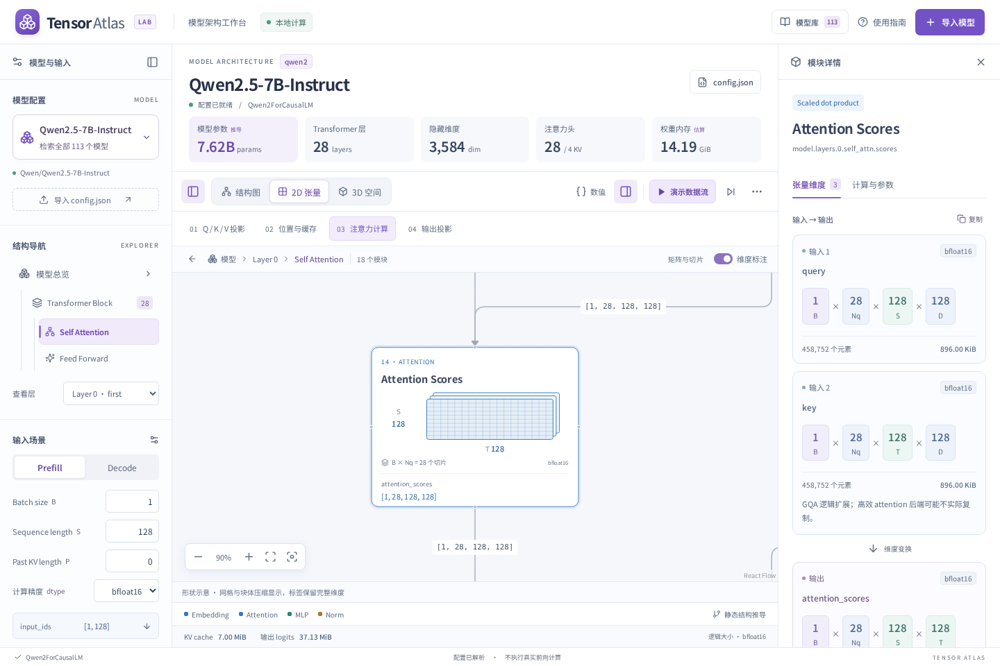
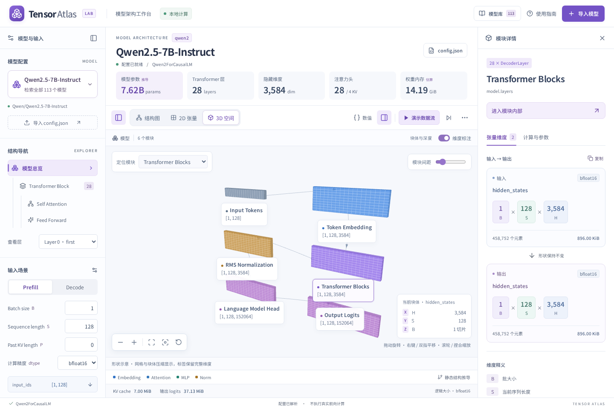
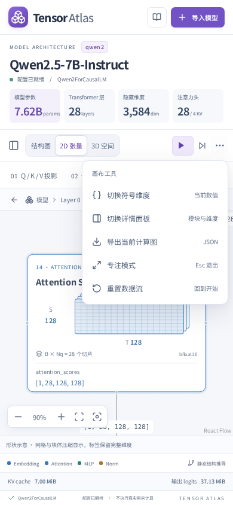

# 三种视图统一后的 UI 评审

2026-10-17，基于真实浏览器页面进行检查与修改。保留当前配置、模型库和维度推导，只调整展示与交互。

## 评审与修改

| 问题                                          | 已实施的调整                                                                                 |
| --------------------------------------------- | -------------------------------------------------------------------------------------------- |
| 结构图、2D、3D 的工具密度和返回导航不一致     | 三种视图统一为视图切换工具栏 + 上下文栏；模型路径、模块数、返回和维度开关固定在画布之外      |
| 浮动标题和维度开关覆盖图中模块                | 从绘图表面移出，保留底部缩放与聚焦工具；2D / 3D 同样提供返回上一级                           |
| 大量相同权重的图标不易辨认                    | 工具栏优先显示三种视图、播放和单步；导出、专注模式、重置放入带文字的工具菜单                 |
| 手机工具栏占两行，单步、专注模式等直接被隐藏  | 工具栏由 83px 减为 54px，单步保持可见，其他操作通过菜单访问；详情和符号切换仍可使用          |
| 模型摘要、侧栏和详情缺乏明显层级              | 指标采用淡色分组，模型参数单独强调；统一边框、圆角、间距及文字层级                           |
| 2D 文字偏小，窗口变窄后选中模块可能离开可视区 | 加大节点标题和维度字重，窗口尺寸改变后重新聚焦当前模块                                       |
| 3D 标签按固定距离隐藏，长标题容易裁切         | 放大标签字体，按实际标签尺寸计算碰撞与边界，优先显示选中模块                                 |
| 模型库字号小，筛选后弹窗位置发生跳动          | 增大名称、来源和结构文字；固定弹窗高度，只滚动结果区；增加清空搜索、重置筛选和无结果恢复按钮 |
| 次要文字对比度不足                            | 调整指标、未选中按钮、模块数、菜单说明、Norm 张量文字及模型库页脚颜色                        |

工具菜单支持方向键、Home / End、Escape 和焦点返回。专注模式下 Escape 优先关闭菜单，再退出专注模式。

## 检查与取舍

检查 1440×960、1280×800、1024×768、768×1024、390×844、360×740，未发现页面或工具栏横向溢出。[布局测量](after-metrics.json) 记录外层画布和实际绘图区域，避免把固定上下文栏计入有效绘图面积。

上下文栏需要固定高度，因此桌面的纯绘图面积有所减少，换来了不被标题遮挡的内容和一致的导航。长图仍通过阶段定位、聚焦、全图与专注模式阅读。手机上的全图缩略预览不能让所有文字同时清晰，应使用阅读视图或点选模块。

原有 424 项单元测试通过。浏览器回归覆盖导入、模型库、Gemma / DeepSeek、2D / 3D、缩放、播放、导出与原有响应式行为；新增菜单键盘操作、手机工具入口、统一返回路径、筛选恢复及 2D 调整窗口后的聚焦检查。

对结构图、工具菜单、模型库、2D、3D、手机工具菜单执行 axe-core 的 WCAG 2 A / AA 与 2.1 AA 自动规则，均无自动检出的违规，详见 [检查结果](accessibility.json)。自动检查不等同完整无障碍认证。

## 截图

[改前桌面](before-1440.png) · [改后桌面](after-1440.png) · [改前模型库](before-library.png) · [改后模型库](after-library.png)

